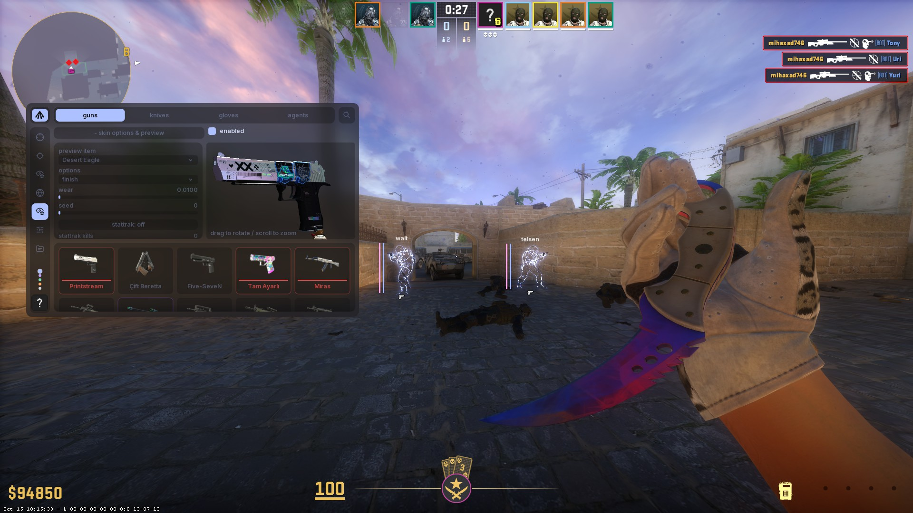

## Requirements

- Visual Studio 2026 with the Desktop development with C++ workload
- MSVC v145 C++ x64/x86 build tools and a Windows 10/11 SDK
- vcpkg integration for Visual Studio
- x64 CPU with AVX2 support
- Internet access for the first dependency restore

FreeType is declared in `cs2/velocity-cs2/vcpkg.json` and restored through
Visual Studio's vcpkg integration using the `x64-windows-static` triplet.
Both configurations use the release static runtime and release dependencies.

## Build Guide

Open `cs2/velocity-cs2.slnx` in Visual Studio, select **Ship | x64** or
**Development | x64**, and choose **Build > Build Solution**.
You can also open `cs2/velocity-cs2/velocity-cs2.vcxproj` directly.

Alternatively, from a Developer Command Prompt at the repository root:

```cmd
msbuild cs2\velocity-cs2\velocity-cs2.vcxproj /p:Configuration=Ship /p:Platform=x64
msbuild cs2\velocity-cs2\velocity-cs2.vcxproj /p:Configuration=Development /p:Platform=x64
```

Outputs are `cs2/bin/cs2.dll` and `cs2/bin/velocity-cs2-dev.dll`.
Intermediate files and compiled modules are isolated under
`cs2/bin/intermediates/<Configuration>/`. Use Visual Studio's Clean/Rebuild
commands, or add `/t:Clean` or `/t:Rebuild` to the corresponding MSBuild command.

The project builds directly with MSVC and MSBuild. MSVC 14.50 or newer is
required: the older 14.42 compiler fails to import the combined module
containing JSON templates.

## Contributing

Contributions are welcome. If you want to help, open a pull request with a clear
description of what changed and why.

Follow the [Google C++ Style Guide](https://google.github.io/styleguide/cppguide.html)
for first-party code. Use `.cc` implementation files, `.cppm` module interface
files, and lowercase filenames with underscores. Reserve `.h` files for
textual platform/macro boundaries, with path-based `VELOCITY_..._H_` guards.
Both build configurations target C++20.

Bundled code under `project/external/` retains its upstream style and filenames.
Windows ABI declarations, engine-facing names in strings, and third-party API
names must retain their required spelling. Keep platform integration includes
in the global module fragment when making style changes.

## Why

I was bored.


